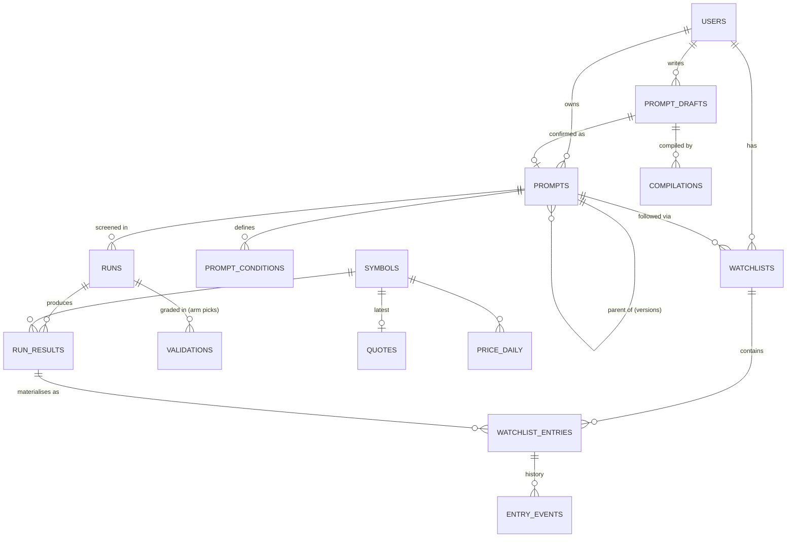

# Prompt Screener — backend plan (v3.2)

Status: plan only. v1–v3.1 were 03 Oct 2026. v3.2 (03 Oct 2026, 19:36) makes two changes:
- Every condition and parameter comes from the user's prompt; nothing is fixed or suggested by the app (O1).
- Near misses and other shadow candidates appear on the watchlist only (O2).

Companion to `docs/prompt-screener-frontend-plan.md` (whose §4 lists the sharing additions planned for v3.3).
Builds on `docs/forward-test-response-and-volume-plan.md` and `docs/literal-spec-plan.md` in this repo, and on the TradingPOC project docs `claude/vstop-weekly-screener-plan.md` and `claude/vstop-pine-parity-plan.md`.

## 0. Decisions (03 Oct 2026)

| # | Decision | Effect on the backend |
|---|---|---|
| D1 | **Only the Literal and T1-literal structures are exposed.** | A prompt runs on one of these two pipelines. No other arm's code path is reachable. |
| D2 | **Prices are fetched when the user opens a watchlist**, from Yahoo / Google Finance, as the current code does. No broker, no streaming. | One on-demand quote call with a short cache. |
| D3 | **Liquidity is the user's call.** Prompt them with ₹10 cr/week and ask for confirmation. | Always asked. The user can confirm, change it or decline it. This is the **only** value the app ever puts in front of the user. |
| D4 | **Local for now.** | SQLite, an in-process job runner, localhost only. |
| D5 | **Every confirmed prompt is logged as a Test arm.** | Its runs write forward records graded against Control. |
| D6 | **All conditions and all parameters come from the user's prompt. Nothing is fixed, defaulted or suggested by the app.** (O1, revised 19:36.) | This covers every VStop parameter (length, mult, source), RSI length and band, cap band, T1 window length and offsets, and the selection point. Anything missing is asked for as an open question with **no pre-filled value**. Liquidity is the one exception (D3). |
| D7 | **Literal and T1-literal are structures, not fixed rule sets.** Conditions inside them can change; the structure is reused where the use case allows. | Each structure step switches on only when the prompt's conditions make it meaningful (§2.2). |
| D8 | **Near misses and other shadow candidates are shown on the watchlist only.** (O2, revised 19:36.) | They are stored and displayed with prices, but **never written to the arm's forward record and never graded**. Only the arm's own picks go to the forward test. |
| D9 | **Each prompt gets a unique, numeric-only identifier.** | `prompt_id` is a positive integer, assigned at confirmation, and is also the arm id in the forward test. |
| D10 | **The database keys on User ID × Prompt ID → Watchlist.** | One watchlist per (user, prompt), schema in §8. |
| D11 | **All ids are numeric.** | Integer identity keys everywhere, §8.1. |

---

## 1. Shape of the system (local)

```
Browser ── http://localhost:3000
   │
Next.js app (Node, TypeScript)
   ├─ Pages + API routes, session (user_id)
   ├─ Prompt compiler (Claude API)
   ├─ Users / prompts / watchlists (SQLite via drizzle — schema portable to Postgres)
   └─ Job runner (in-process, jobs table)
   │  HTTP 127.0.0.1:8001
Python engine (FastAPI, imports trading-agent)
   ├─ Structures: literal, t1_literal
   ├─ Condition evaluator (exactly the conditions the spec carries — nothing added)
   ├─ Quotes (existing Yahoo / Google Finance fetcher)
   └─ Forward-record writer (same store as the weekly run; arm picks only)
```

---

## 2. Spec = structure + the user's conditions

### 2.1 Shape

Every value below has to come from the user, either in the prompt or as an answer to a question. The example is your original brief, written out in full.

```json
{
  "spec_version": 4,
  "structure": "literal",
  "timeframe": "1W",
  "selection_point": {"session_of_week": 1, "at": "open"},
  "conditions": [
    {"id": "C1", "role": "filter", "kind": "field", "name": "mcap_cr", "op": "between", "value": [10000, 50000]},
    {"id": "C2", "role": "filter", "kind": "field", "name": "traded_value_cr", "params": {"window": "1W"}, "op": ">=", "value": 10},
    {"id": "C3", "role": "event", "kind": "indicator", "name": "vstop", "params": {"length": 10, "mult": 2, "source": "close"}, "op": "flip", "dir": "long"},
    {"id": "C4", "role": "filter", "kind": "indicator", "name": "rsi", "params": {"length": 14}, "op": "between", "value": [50, 65]}
  ],
  "stop": {"from": "C3"},
  "risk_cap_pct": null,
  "near_miss": {"max_failed": 1}
}
```

For a `t1_literal` spec, the user also gives the window:

```json
"t1_window": {"length_sessions": 5, "offsets": [0, 1, 2, 3, 4]}
```

Rules:
- **Only what the user said.**
  - If the prompt doesn't mention market cap, there is no market-cap filter.
  - If it doesn't state a stop, `stop` is null and risk / R show as "—".
  - If it doesn't state a risk cap, there is none.
- **No parameter is fixed (D6).** That includes:
  - VStop length, mult and source
  - RSI length and band
  - every threshold and window
  - T1 window length and offsets
  - the selection point
- **Required items are asked for, never filled in.** If a condition is named without its parameters (for example "VStop flip" with no length or mult), or the structure needs something the prompt didn't give (a selection point, a T1 window), it becomes an open question. The spec is not confirmable until it is answered.
- **How VStop is calculated is not a parameter.** The engine computes VStop one way only, using the TradingView Pine v6 "Volatility Stop" formula (pine-parity plan). This is the calculation method, not a condition, so it is not something the user picks. Every number that goes into it does come from the user.
- **Condition vocabulary.** A condition is `field | indicator` + `params` + `op` + `value`. The engine's `/conditions` catalog lists what it can compute and which params each item **requires**. The catalog has **no default values**; it lists required params and their valid ranges only.
  - A condition the engine can't compute is returned as **unsupported**. It is never dropped or swapped for something similar.
  - The user removes it, or it is added to the engine later.
- **`role`** is set by the compiler and confirmed by the user:
  - `filter`: must be true at the evaluation bar.
  - `event`: something that happens, such as a flip or a cross. Drives the selection-point re-check and T1's window.
  - `stop`: supplies the stop level.
- **`spec_hash`** = sha256 of the canonical spec. This is a content fingerprint, not an id.

### 2.2 What each structure contributes, and when it applies

| Structure step | Literal | T1-literal | Switches on only if… |
|---|---|---|---|
| Evaluate on completed weekly bar (Fri close) | ✓ | ✓ | always |
| Event detection window | Friday bar only | **the user's `t1_window`** (length and offsets) | the spec has at least one `event` condition; otherwise T1 behaves like Literal and the UI says so |
| Re-check event at selection point (`vstop_at_point` etc.) | ✓ | ✓ | the user gave a selection point **and** the event can be evaluated on a partial bar (VStop flip yes; others as they are added) |
| EP = price at selection point | ✓ | ✓ | the user gave a selection point |
| SL | from the `stop` condition | same | the spec has a `stop` |
| Risk cap rejection | ✓ | ✓ | the user set `risk_cap_pct` |
| Sector grouping / highlight | ✓ | ✓ | always (display only, never a filter) |
| Validation 1 / 2 / 3 weeks vs Control | ✓ | ✓ | always, **for arm picks only** (D8) |
| T1 fields: `window_offset`, `days_since_flip`, reversal rate | — | ✓ | T1 with an event condition |

The engine returns an `applied_steps` list with every run, so the UI can show which parts of the structure were actually used.

---

## 3. Prompt compiler (Node → Claude API)

**Output:**
- a draft spec containing only values found in the prompt
- `source_phrases`: condition / param → the words it came from
- `needs_input`: every required value that is missing, phrased as a question
- `unsupported`

**Nothing is supplied by the app (D6).**
- The compiler must not output any value that isn't in the prompt text.
- `needs_input` items carry **no `suggested` field**. Examples:
  - "VStop flip" → "What VStop length, multiplier and source?"
  - "RSI between 50 and 65" → "What RSI length?"
  - T1-literal with no window → "Over how many sessions, and which offsets?"
  - no selection point → "When should the signal be re-checked and the entry taken?"
- A deterministic post-check rejects any number in the spec that isn't traceable to `source_phrases` or to a user answer. This test is not left to the model.

**The one exception: liquidity (D3).**
- It is always raised, even if the prompt never mentions it.
- It shows ₹10 cr/week, and the user must explicitly pick one of three: confirm it, set their own number, or "no liquidity filter".
- If declined, no condition is added.

**Structure choice:**
- `literal` when the prompt describes a weekly close signal.
- `t1_literal` when it asks for events caught during the week or on a rolling window.
- Otherwise `needs_input`.

**Checking and audit.** Output is validated with zod against `/conditions` (required params present, values in range) and the structure schema. If it fails, it retries once with the errors; if it fails again, it returns a 422. Every compile is stored in `compilations`.

**Confirm gate.** A draft can be confirmed only when:
- `needs_input` is empty
- no condition is unsupported
- the hypothesis is filled in (D5)

Confirming creates the prompt and assigns its `prompt_id` (§5).

---

## 4. Python engine (FastAPI on 127.0.0.1:8001)

| Endpoint | Does |
|---|---|
| `GET /structures` | Literal and T1-literal: their steps, and which spec fields each step **requires** (e.g. T1 requires `t1_window` when an event is present; EP requires `selection_point`) |
| `GET /conditions` | Computable fields, indicators and ops, with their **required** params and valid ranges. No defaults. Generated from code |
| `POST /screen` | `{spec, as_of}` → funnel per condition, `applied_steps`, and **every candidate** with its membership: `full_match`, `near_miss` (failed ≤ `max_failed` conditions, with `failed_ids`) or `rejected_risk_cap`. Also per-condition values, EP/SL draft and confidence; T1 fields where applicable. Rejects any spec with a missing required param — it never fills one in |
| `POST /select` | `{spec, as_of, symbols}` → re-check at the selection point. For arm picks: `entered`, `not_confirmed` or `no_point_data`, plus EP. For shadow candidates: only the point price, recorded as a **reference price** for watchlist display |
| `POST /validate` | `{prompt_id, run_id}` → 1-, 2- and 3-week returns for the **arm's picks only**, against Control on the same weeks |
| `POST /quotes` | `{symbols}` → latest price through the existing fetcher; per-symbol errors |
| `GET /series/{symbol}` | Weekly OHLC plus series for the indicators in the prompt's conditions, using the prompt's own params |
| `POST /arms/register`, `POST /arms/{prompt_id}/retire` | Arm registry and forward-test log entries, keyed by the numeric `prompt_id` |
| `GET /health` | Last completed bar date, snapshot hash, engine git SHA |

**Forward-record writer (D8).** It receives **only** the arm's picks: `full_match` candidates, with their selection-point outcome. Near misses, risk-cap rejects and other shadow candidates are never passed to it.

**Parity test (P0).** A prompt that states your original brief in full (cap band, liquidity, VStop 10/2/close, RSI 14 in 50–65, Monday open) must reproduce the Literal arm's forward record for the same `as_of` exactly. The same applies to T1-literal, with its window stated in the prompt.

---

## 5. Prompt IDs and arms (D5, D9)

- **`prompt_id` is numeric only**: a positive integer such as `1`, `2` or `37`, shown as "Prompt 37".
  - **Assigned at confirmation** by the database's identity sequence. Drafts live in `prompt_drafts` with their own numeric `draft_id` and never use up a prompt number.
  - **Never reused** (SQLite `AUTOINCREMENT` / Postgres identity). Prompts are never deleted.
  - **Increasing.** Numbers are unique, not guaranteed contiguous.
- **The prompt id is the arm id** in the forward-test registry and log, recorded as `arm_source = 'prompt'`, `arm_id = 37`. This keeps it separate from the named stock arms.
- **What the arm's forward record holds (D8):** that week's full matches and their selection-point outcome (entered / not confirmed / no point data), with EP and SL. **It holds nothing else.**
- **Edits never mutate a confirmed prompt.** Editing opens a new draft; confirming it creates a **new prompt** with:
  - a new number
  - `parent_prompt_id` pointing at the old one
  - `version` + 1

  The old prompt becomes `superseded`. Its arm and records are kept and it stops being graded.
- **Retire** keeps everything and stops grading.
- **Matching a stock arm.** If a confirmed spec equals the stock Literal or T1-literal arm's spec, the prompt is marked `tracks_stock_arm` and its watchlist reads that arm's records. No duplicate arm is registered.
- **Graded vs not graded.** Only scheduled runs feed the arm's graded series. Dry runs are stored for display and marked `kind = dry_run`.

---

## 6. Prices on demand (D2)

- 60-second cache during market hours
- debounced Refresh button
- "Prices as of HH:MM (Yahoo, may be delayed)"
- failed symbols show the cached price tagged stale
- **prices are fetched for every watchlist entry, shadow ones included**
- **"Since added"**:
  - for arm picks, measured from the selection-point EP
  - for shadow candidates, measured from their **reference price** (the price at the selection point), labelled "since ref."
  - shadow returns are **display only**: they are not stored in `validations` and not sent to the forward test

---

## 7. Jobs (local, D4)

- `weekly_screen`, `select_entry` and `validate_prior` are all triggered by the existing weekly run's completion hook.
- `catch_up` runs on startup for missed weeks.
- The freshness gate holds jobs when data is stale.
- Jobs are idempotent per `(type, prompt_id, as_of)`.
- `weekly_screen` writes every candidate into `run_results`, and then into every watchlist following that prompt (§8.3). Only full matches go on to the forward record.
- `select_entry` sets entry status and EP for arm picks, and the reference price for shadow candidates.
- `validate_prior` grades arm picks only.

---

## 8. Database design (D10, D11)

### 8.1 Choice of database

- **SQLite now**, as a single file at `data/app.db`, with WAL mode on.
- **Written to be portable to Postgres**:
  - **Numeric ids only.** Every primary key is `INTEGER PRIMARY KEY AUTOINCREMENT` in SQLite, which maps to `BIGINT GENERATED ALWAYS AS IDENTITY` in Postgres.
  - ISO-8601 UTC timestamps as TEXT
  - JSON stored as TEXT with `CHECK (json_valid(...))`
  - no SQLite-only features in the app's queries
- **Access layer:** drizzle ORM, with migrations in `db/migrations/`.
- **Separation of stores.** Market research data stays in the engine's PIT store, and forward records stay in the trading-agent's store. This database holds users, prompts, watchlists, runs (for display) and caches.
- **Symbols** keep their NSE ticker as the natural key (the market's identifier, not an app id).

### 8.2 Entity relationships



The core key is **one watchlist per (user_id, prompt_id)**:
- A prompt has one owner.
- The schema also lets another user follow the same prompt later, with their own watchlist over the same shared run results.

### 8.3 How a run fills watchlists

1. `runs` gets one row per prompt per `as_of`.
2. `run_results` gets one row per candidate, with its membership (`full_match`, `near_miss` or `rejected_risk_cap`) and `in_forward_record` (1 only for full matches on scheduled runs).
3. For **each** watchlist with that `prompt_id`, upsert into `watchlist_entries`:
   - **New candidate:** a new entry with `first_run_id` set to this run, membership from the result, status `pending_selection`.
   - **Existing open entry for the same symbol:** update `last_run_id` and membership (for example, near miss → full match), and log an `entry_events` row for the change.
   - **Open entry not in this run's candidates:** status → `dropped_from_screen`. It stays visible.
4. `select_entry`:
   - for **full matches**, sets status to `entered`, `not_confirmed` or `no_point_data`, and fills `entry_price` and `stop`
   - for **shadow entries**, sets status to `watching` and fills `ref_price` only
5. A user removing a stock only changes **their** entry (`removed_by_user`). The run results and the forward record are untouched.
6. A symbol that leaves and later re-qualifies gets a **new** entry. It doesn't reopen the old one.

### 8.4 Tables (DDL, SQLite dialect)

```sql
-- Who
CREATE TABLE users (
  user_id        INTEGER PRIMARY KEY AUTOINCREMENT,
  display_name   TEXT NOT NULL,
  email          TEXT UNIQUE,
  password_hash  TEXT,                             -- argon2id; NULL for the local default user
  role           TEXT NOT NULL DEFAULT 'member' CHECK (role IN ('owner','member')),
  status         TEXT NOT NULL DEFAULT 'active' CHECK (status IN ('active','disabled')),
  created_at     TEXT NOT NULL
);

-- Work in progress; never consumes a prompt number
CREATE TABLE prompt_drafts (
  draft_id          INTEGER PRIMARY KEY AUTOINCREMENT,
  user_id           INTEGER NOT NULL REFERENCES users(user_id),
  parent_prompt_id  INTEGER REFERENCES prompts(prompt_id),   -- set when editing a confirmed prompt
  title             TEXT,
  prompt_text       TEXT NOT NULL CHECK (length(prompt_text) <= 2000),
  structure         TEXT CHECK (structure IN ('literal','t1_literal')),
  spec_json         TEXT CHECK (spec_json IS NULL OR json_valid(spec_json)),
  needs_input_json  TEXT CHECK (needs_input_json IS NULL OR json_valid(needs_input_json)),  -- open questions, no suggested values (liquidity excepted)
  answers_json      TEXT CHECK (answers_json IS NULL OR json_valid(answers_json)),          -- the user's answers, verbatim
  hypothesis        TEXT,
  kill_criterion    TEXT,
  status            TEXT NOT NULL DEFAULT 'open' CHECK (status IN ('open','confirmed','abandoned')),
  confirmed_prompt_id INTEGER REFERENCES prompts(prompt_id),
  created_at        TEXT NOT NULL,
  updated_at        TEXT NOT NULL
);
CREATE INDEX ix_drafts_user ON prompt_drafts(user_id, status);

CREATE TABLE compilations (
  compilation_id INTEGER PRIMARY KEY AUTOINCREMENT,
  draft_id       INTEGER NOT NULL REFERENCES prompt_drafts(draft_id),
  model          TEXT NOT NULL,
  raw_json       TEXT NOT NULL CHECK (json_valid(raw_json)),
  errors_json    TEXT CHECK (errors_json IS NULL OR json_valid(errors_json)),
  created_at     TEXT NOT NULL
);

-- Confirmed prompts only; prompt_id = the number the user sees = the arm id
CREATE TABLE prompts (
  prompt_id         INTEGER PRIMARY KEY AUTOINCREMENT,
  owner_user_id     INTEGER NOT NULL REFERENCES users(user_id),
  draft_id          INTEGER NOT NULL UNIQUE REFERENCES prompt_drafts(draft_id),
  title             TEXT NOT NULL,
  prompt_text       TEXT NOT NULL CHECK (length(prompt_text) <= 2000),
  structure         TEXT NOT NULL CHECK (structure IN ('literal','t1_literal')),
  spec_json         TEXT NOT NULL CHECK (json_valid(spec_json)),
  spec_hash         TEXT NOT NULL,
  status            TEXT NOT NULL DEFAULT 'confirmed'
                    CHECK (status IN ('confirmed','superseded','retired')),
  parent_prompt_id  INTEGER REFERENCES prompts(prompt_id),
  version           INTEGER NOT NULL DEFAULT 1,
  hypothesis        TEXT NOT NULL,
  kill_criterion    TEXT NOT NULL,
  tracks_stock_arm  TEXT CHECK (tracks_stock_arm IN ('literal','t1_literal')),
  review_week       INTEGER,
  confirmed_at      TEXT NOT NULL,
  closed_at         TEXT
);
CREATE INDEX ix_prompts_owner ON prompts(owner_user_id, status);
CREATE UNIQUE INDEX ux_prompts_owner_spec ON prompts(owner_user_id, spec_hash)
  WHERE status = 'confirmed';

-- The confirmed conditions, normalised for querying
CREATE TABLE prompt_conditions (
  prompt_id      INTEGER NOT NULL REFERENCES prompts(prompt_id),
  cond_no        INTEGER NOT NULL,                 -- 1..n (shown as C1..Cn)
  role           TEXT NOT NULL CHECK (role IN ('filter','event','stop')),
  kind           TEXT NOT NULL CHECK (kind IN ('field','indicator')),
  name           TEXT NOT NULL,
  params_json    TEXT CHECK (params_json IS NULL OR json_valid(params_json)),
  op             TEXT NOT NULL,
  value_json     TEXT CHECK (value_json IS NULL OR json_valid(value_json)),
  value_origin   TEXT NOT NULL CHECK (value_origin IN ('prompt','user_answer')),  -- never 'default'
  source_phrase  TEXT,                             -- the user's words (prompt or answer)
  PRIMARY KEY (prompt_id, cond_no)
);
CREATE INDEX ix_conditions_name ON prompt_conditions(name);

-- User × Prompt → Watchlist
CREATE TABLE watchlists (
  watchlist_id   INTEGER PRIMARY KEY AUTOINCREMENT,
  user_id        INTEGER NOT NULL REFERENCES users(user_id),
  prompt_id      INTEGER NOT NULL REFERENCES prompts(prompt_id),
  name           TEXT NOT NULL,
  created_at     TEXT NOT NULL,
  archived_at    TEXT,
  UNIQUE (user_id, prompt_id)
);
CREATE INDEX ix_watchlists_prompt ON watchlists(prompt_id);

-- Screens
CREATE TABLE runs (
  run_id              INTEGER PRIMARY KEY AUTOINCREMENT,
  prompt_id           INTEGER NOT NULL REFERENCES prompts(prompt_id),
  as_of               TEXT NOT NULL,
  kind                TEXT NOT NULL CHECK (kind IN ('scheduled','catch_up','dry_run')),
  status              TEXT NOT NULL CHECK (status IN ('queued','running','done','failed','blocked_stale_data')),
  applied_steps_json  TEXT CHECK (applied_steps_json IS NULL OR json_valid(applied_steps_json)),
  funnel_json         TEXT CHECK (funnel_json IS NULL OR json_valid(funnel_json)),
  data_snapshot_hash  TEXT,
  engine_version      TEXT,
  forward_record_ref  TEXT,                        -- NULL for dry runs
  started_at TEXT, finished_at TEXT, error TEXT
);
CREATE UNIQUE INDEX ux_runs_graded ON runs(prompt_id, as_of) WHERE kind <> 'dry_run';

CREATE TABLE symbols (
  symbol   TEXT PRIMARY KEY,                       -- NSE ticker
  name     TEXT, sector TEXT, isin TEXT UNIQUE,
  active   INTEGER NOT NULL DEFAULT 1
);

CREATE TABLE run_results (
  run_id            INTEGER NOT NULL REFERENCES runs(run_id),
  symbol            TEXT NOT NULL REFERENCES symbols(symbol),
  membership        TEXT NOT NULL CHECK (membership IN ('full_match','near_miss','rejected_risk_cap')),
  in_forward_record INTEGER NOT NULL DEFAULT 0 CHECK (in_forward_record IN (0,1)),
  failed_conds_json TEXT CHECK (failed_conds_json IS NULL OR json_valid(failed_conds_json)),
  cond_json         TEXT NOT NULL CHECK (json_valid(cond_json)),
  metrics_json      TEXT CHECK (metrics_json IS NULL OR json_valid(metrics_json)),
  ep REAL, sl REAL, ref_price REAL, confidence REAL,
  window_offset INTEGER, days_since_flip INTEGER,
  entry_status      TEXT CHECK (entry_status IN ('pending_selection','entered','not_confirmed','no_point_data','watching')),
  PRIMARY KEY (run_id, symbol),
  -- shadow candidates can never be in the forward record (D8)
  CHECK (in_forward_record = 0 OR membership = 'full_match')
);
CREATE INDEX ix_results_membership ON run_results(run_id, membership);

-- Per-user watchlist rows (arm picks and shadow candidates)
CREATE TABLE watchlist_entries (
  entry_id       INTEGER PRIMARY KEY AUTOINCREMENT,
  watchlist_id   INTEGER NOT NULL REFERENCES watchlists(watchlist_id),
  symbol         TEXT NOT NULL REFERENCES symbols(symbol),
  first_run_id   INTEGER NOT NULL REFERENCES runs(run_id),
  last_run_id    INTEGER NOT NULL REFERENCES runs(run_id),
  membership     TEXT NOT NULL CHECK (membership IN ('full_match','near_miss','rejected_risk_cap')),
  status         TEXT NOT NULL CHECK (status IN ('pending_selection','entered','not_confirmed',
                   'no_point_data','watching','dropped_from_screen','stopped_out','removed_by_user','closed')),
  entry_date TEXT, entry_price REAL, stop REAL,   -- arm picks only
  ref_price      REAL,                             -- shadow entries only (display)
  user_note      TEXT,
  created_at TEXT NOT NULL, updated_at TEXT NOT NULL,
  UNIQUE (watchlist_id, symbol, first_run_id),
  CHECK (membership = 'full_match' OR entry_price IS NULL)
);
CREATE INDEX ix_entries_list ON watchlist_entries(watchlist_id, status, membership);
CREATE UNIQUE INDEX ux_entries_open ON watchlist_entries(watchlist_id, symbol)
  WHERE status NOT IN ('dropped_from_screen','stopped_out','removed_by_user','closed');

CREATE TABLE entry_events (
  event_id   INTEGER PRIMARY KEY AUTOINCREMENT,
  entry_id   INTEGER NOT NULL REFERENCES watchlist_entries(entry_id),
  run_id     INTEGER REFERENCES runs(run_id),
  type       TEXT NOT NULL,                        -- added, membership_changed, entered, not_confirmed, watching, dropped, stopped_out, removed, restored
  from_value TEXT, to_value TEXT,
  at         TEXT NOT NULL
);
CREATE INDEX ix_events_entry ON entry_events(entry_id, at);

-- Grading: arm picks only (D8)
CREATE TABLE validations (
  run_id            INTEGER NOT NULL REFERENCES runs(run_id),
  horizon_w         INTEGER NOT NULL CHECK (horizon_w IN (1,2,3)),
  n                 INTEGER NOT NULL,
  ew_return         REAL, control_ew_return REAL, hit_rate REAL,
  computed_at       TEXT NOT NULL,
  PRIMARY KEY (run_id, horizon_w)
);

-- Prices
CREATE TABLE quotes (
  symbol TEXT PRIMARY KEY REFERENCES symbols(symbol),
  price REAL, chg_pct REAL, source TEXT, source_ts TEXT, fetched_at TEXT NOT NULL, error TEXT
);
CREATE TABLE price_daily (
  symbol TEXT NOT NULL REFERENCES symbols(symbol),
  date   TEXT NOT NULL, o REAL, h REAL, l REAL, c REAL,
  PRIMARY KEY (symbol, date)
);

-- Jobs
CREATE TABLE jobs (
  job_id     INTEGER PRIMARY KEY AUTOINCREMENT,
  type       TEXT NOT NULL,
  prompt_id  INTEGER REFERENCES prompts(prompt_id),
  as_of      TEXT,
  status     TEXT NOT NULL CHECK (status IN ('queued','running','done','failed','blocked_stale_data')),
  attempts   INTEGER NOT NULL DEFAULT 0,
  error      TEXT, created_at TEXT NOT NULL, finished_at TEXT,
  UNIQUE (type, prompt_id, as_of)
);
```

Notes on the DDL:
- **Circular reference.** `prompt_drafts.parent_prompt_id` refers to `prompts`. Both tables are created in one migration.
- **Condition labels.** Condition numbers are stored as integers (`cond_no`); "C1" is display only.
- **`value_origin` is the database-level guard for D6.** It only allows `prompt` or `user_answer`, so no condition value can be stored as a default.
- **The `run_results` and `watchlist_entries` CHECKs are the database-level guard for D8.** A shadow candidate can't be marked as part of the forward record or given an entry price.

### 8.5 Integrity rules (enforced in code, tested)

- **Prompt numbers are assigned only at confirmation**, in one transaction that writes `prompts` and `prompt_conditions` and marks the draft `confirmed`.
- **Every spec value is traceable at confirm.** Every value in `spec_json` must appear in `prompt_conditions` with `value_origin` `prompt` or `user_answer`. The liquidity answer is stored as `user_answer`, even when the user accepted ₹10 cr/week.
- **Confirmed prompts are immutable.** Any change goes through a new draft → a new `prompt_id`.
- **Nothing is hard-deleted.** Prompt numbers are never reused.
- **Every watchlist follows a confirmed prompt.** It is archived when its prompt is superseded.
- **Foreign keys on.** `PRAGMA foreign_keys = ON` for every connection.

### 8.6 Main queries (and the indexes behind them)

| Need | Query path |
|---|---|
| A user's watchlists | `watchlists WHERE user_id = ?` → join `prompts` |
| Dashboard | `watchlist_entries WHERE watchlist_id = ?` (`ix_entries_list`) → join `run_results` on `last_run_id` + `symbol` → `quotes` |
| Detail | entry → `entry_events` timeline + `run_results` cond values + `/series` |
| Arm history | `runs WHERE prompt_id = ? AND kind <> 'dry_run'` → `validations` |
| What goes to the forward test | `run_results WHERE run_id = ? AND in_forward_record = 1` |
| Prompts using a condition | `prompt_conditions WHERE name = 'rsi'` |
| Version chain | recursive CTE on `parent_prompt_id` |

### 8.7 Users on a local install

- `setup` creates one **owner** user (user_id 1) with no password, using an OS-user session.
- Adding more users is just more rows in `users`, plus switching on login (argon2id password, session cookie).
- Every API route already scopes by `user_id` from the session, so this needs no schema change.

---

## 9. Local safety

- Both processes bind to `127.0.0.1`.
- Keys are kept in `.env.local`.
- The forward store is written only through the engine, and only with arm picks.
- `data/app.db` is backed up nightly with `sqlite3 .backup`.

---

## 10. Tests

| Area | Must pass |
|---|---|
| No app-supplied values | For each of at least 20 prompts, every number in the confirmed spec maps to a `source_phrase` or a user answer. "VStop flip" with no params → confirm is blocked until the user answers. The `/conditions` catalog contains no default values |
| Liquidity exception | Liquidity is always asked; it can't be confirmed without one of the three explicit choices; "no liquidity filter" adds no condition |
| Open parameters | VStop(14,3), RSI(9) and a 3-session T1 window in a prompt compile and run, and the engine output reflects them |
| Structure applicability | No event condition: `applied_steps` excludes the re-check and T1 equals Literal. No stop → `sl` null. No selection point given → the draft can't be confirmed |
| Shadow = watchlist only | Near misses and risk-cap rejects appear as entries with `ref_price` and quotes; they never appear in the forward record, never in `validations`, and the DB CHECKs reject any attempt |
| Numeric ids | Every id the API returns or the UI shows is a positive integer |
| Prompt numbering | Assigned only at confirm; abandoned drafts don't use a number; never reused; edits give a new number with `parent_prompt_id` |
| User × Prompt | A second watchlist for the same (user, prompt) is rejected; two users share `run_results` with independent removals |
| Open-entry uniqueness | Re-qualifying after a drop creates a new entry |
| Parity | Your brief, stated in full in a prompt, reproduces the Literal forward record exactly; the same for T1-literal with its window stated |

---

## 11. Build phases

| Phase | Scope | Done when |
|---|---|---|
| P0 | Engine `/structures`, `/conditions` (required params, no defaults), `/screen`, `/select`, `/health` | Parity is exact for a fully stated Literal and T1-literal spec |
| P1 | SQLite schema + migrations, local owner user, drafts + manual form (every value entered by the user), confirm → numeric `prompt_id`, watchlist with shadow entries, quotes on open | You can confirm a prompt and open its watchlist with all membership types |
| P2 | Arm registration keyed by `prompt_id`, weekly hook, `select_entry` (EP for picks, ref price for shadows), `validate_prior` (picks only), `catch_up`, versioning | A full weekly cycle runs untouched; the forward record holds only arm picks |
| P3 | Prompt compiler with the no-supplied-values check, liquidity question, regression set | Regression set passes, including the traceability checks |

---

## 12. Closed

- **O1** → D6: no parameter is fixed. Every condition and parameter comes from the user's prompt or their answer to a question. The app suggests nothing except the liquidity prompt (D3).
- **O2** → D8: near misses and other shadow candidates are shown on the watchlist only. They are not recorded on the forward record and not graded.
- **O3** → D9 / D11: numeric-only ids; `prompt_id` is the arm id.
- **N2** → in scope (03 Oct, 19:42). Sharing and following are designed in the frontend plan §3.4; the schema additions it needs are listed in the frontend plan §4, to be folded in here as v3.3.

## 13. Still open

- **N1. Near-miss depth.** The frontend now asks for it as a question with no default (0 = no near misses), in line with D6. The spec example above still shows `max_failed: 1`, which here means the user answered 1.
